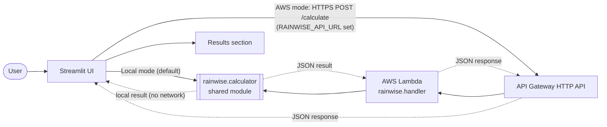

# RainWise — Every Drop Has Potential.

**Environmental Hacks 2026 · Track: Heat & Water**

RainWise estimates how much rainwater a roof could collect during one rainfall event and recommends the smallest suitable standard storage tank. It does one thing and explains it transparently.

## Problem and solution

Households, schools and colleges often let rooftop rainwater flow into drains because they have no simple way to estimate their potential harvest or choose a tank. RainWise takes three inputs (roof area, rainfall, collection efficiency), shows the estimated harvest in litres and kilolitres, recommends a tank, and displays the formula and assumptions behind the number.

**Target users:** homeowners, school and college facility managers, and anyone planning a first rainwater-storage setup.

**Why it matters:** the first planning step is knowing the order of magnitude. A clear, honest estimate helps people judge whether harvesting is worthwhile and size storage sensibly before spending money. RainWise supports water planning only; it does not measure or claim water actually saved.

## Formula and limitations

```
harvestable_litres = roof_area_m2 × rainfall_mm × efficiency_percent / 100
```

1 mm of rain on 1 m² equals 1 litre. Example: 200 m² × 50 mm × 80 % = **8,000 L** → recommended tank **10,000 L**.

Standard tanks: 500, 1,000, 2,000, 5,000, 10,000 and 20,000 L. The smallest tank ≥ the estimate is recommended. Above 20,000 L the app says multiple tanks or a larger system may be needed. With zero rainfall (or 0 % efficiency) it shows zero harvest and no tank.

This is a **preliminary estimate for a single rainfall event**. Real collection depends on rainfall distribution, first-flush diversion, roof material, leakage, overflow and other site factors.

## Architecture



- **Local mode:** the UI imports the calculator and calls it directly. No network, no AWS, and the status badge says *Local calculation*.
- **AWS mode:** the Streamlit server sends a real HTTP request to `RAINWISE_API_URL`. The badge says *AWS API connected* only after a request has actually succeeded, and *AWS API unavailable* when it fails. There is **no silent fallback**; on failure you see an error and a button to switch to local mode.
- One calculation implementation (`src/rainwise/calculator.py`) serves both paths. The backend is stateless.

## Technology

Python 3.12 · Streamlit (custom CSS + inline SVG) · AWS Lambda · Amazon API Gateway HTTP API · AWS SAM · pytest. Only the Python standard library is used for calculation, the HTTP client and CSV.

## Project layout

```
app.py                  Streamlit landing page and results
api_client.py           stdlib HTTP client for AWS mode
ui_assets.py            CSS and inline SVG (hero scene, tank)
src/rainwise/
  calculator.py         shared calculation + validation
  handler.py            Lambda handler (POST /calculate)
template.yaml           SAM: Lambda + HTTP API + route
events/calculate.json   sample API Gateway event
scripts/local_api.py    dev-only HTTP wrapper around the handler (no Docker/AWS)
tests/                  calculator + handler tests
.streamlit/config.toml  light theme and palette
```

Note: the Lambda package root is `src/` so the shared `calculator.py` ships inside the function without duplication.

## Local setup

```bash
python -m venv .venv
source .venv/bin/activate          # Windows: .venv\Scripts\activate
pip install -r requirements.txt
streamlit run app.py
```

Open http://localhost:8501. With no `RAINWISE_API_URL`, the app runs fully offline in local mode.

Optional: `cp .env.example .env` and set `RAINWISE_API_URL` (never commit `.env`).

## Tests

```bash
python -m pytest -q
```

Covers the 8,000 L example, zero rainfall, zero efficiency, negative/invalid inputs, out-of-range efficiency, the >20,000 L case, tank boundaries, and malformed backend requests (bad JSON, NaN/Infinity, missing fields, wrong types, oversized body).

## AWS deployment (SAM)

Prerequisites: an AWS account, AWS CLI configured (`aws configure`), and [AWS SAM CLI](https://docs.aws.amazon.com/serverless-application-model/latest/developerguide/install-sam-cli.html).

```bash
sam validate --lint
sam build
sam deploy --guided      # accept defaults, pick your region, allow IAM role creation
```

When it finishes, copy the **CalculateUrl** output. It looks like `https://<id>.execute-api.<region>.amazonaws.com/calculate`.

Test the backend locally first (needs Docker):

```bash
sam local invoke RainWiseFunction -e events/calculate.json
sam local start-api            # then POST to http://127.0.0.1:3000/calculate
```

No Docker? Run `python scripts/local_api.py` (the real handler behind a tiny local HTTP server on port 3000).

### Verify the real API

```bash
curl -X POST "$RAINWISE_API_URL" -H "Content-Type: application/json" \
  -d '{"roof_area_m2":200,"rainfall_mm":50,"efficiency_percent":80}'
```

PowerShell:

```powershell
Invoke-RestMethod -Method Post -Uri $env:RAINWISE_API_URL -ContentType "application/json" `
  -Body '{"roof_area_m2":200,"rainfall_mm":50,"efficiency_percent":80}'
```

Expected: `harvestable_litres` 8000.0, `recommended_tank_litres` 10000. A bad body (e.g. `{"roof_area_m2":-1}`) returns HTTP 400 with `details`.

### Connect the app

```bash
export RAINWISE_API_URL="https://<id>.execute-api.<region>.amazonaws.com/calculate"   # PowerShell: $env:RAINWISE_API_URL="..."
streamlit run app.py
```

Press **Calculate**; the badge shows *AWS API connected* only after a successful response. Use the mode switch to go back to local.

### Troubleshooting

| Symptom | Fix |
|---|---|
| `sam: command not found` | Install SAM CLI and reopen the terminal |
| `Unable to locate credentials` | Run `aws configure` (or set `AWS_PROFILE`) |
| `sam local ...` fails with a container error | Start Docker Desktop, or use `scripts/local_api.py` |
| `CREATE_FAILED` / IAM permission error | Use credentials allowed to create Lambda, API Gateway and IAM roles; re-run with `--capabilities CAPABILITY_IAM` |
| Stack stuck in `ROLLBACK_COMPLETE` | `sam delete`, then redeploy |
| App says *AWS API unavailable* | URL must include `/calculate`; check region, internet, and test with the curl command above |
| HTTP 403/404 | Wrong path or stack not deployed; use the exact `CalculateUrl` output |
| Clean up | `sam delete` removes the stack |

Security notes: no credentials, account IDs or URLs are hard-coded. The Lambda has only the basic CloudWatch Logs role and no other AWS access. API Gateway throttling is enabled. HTTP APIs have no built-in body-schema validation, so validation runs in the Lambda (and again in the UI). No browser CORS config is needed because Streamlit calls the API from Python.

## AI coding tools used

Claude (Anthropic) assisted with code generation, tests, UI design and documentation. All behaviour was run and tested locally. *(Edit this line to list exactly what you used.)*

## Limitations and future improvements

- Single-event estimate; no monthly or annual rainfall model.
- Standard tank sizes are fixed; no pricing or supplier data.
- Future ideas (not built): region rainfall presets, seasonal totals, a downloadable PDF plan.
- Deployment status: see the checklist in your submission notes; do not claim a deployed URL until the curl test above succeeds.

---

## Hackathon submission text

**Short description:** RainWise helps households, schools and colleges see how much rainwater their roof could collect and which standard tank fits. Enter roof area, rainfall and collection efficiency to get an estimate in litres, a tank recommendation, and the full formula and assumptions. It runs locally and can call a serverless AWS API (Lambda + API Gateway) that uses the same calculation code.

**Environmental impact statement:** RainWise does not collect water itself. It lowers a planning barrier: when people can quickly see a realistic order of magnitude and a suitable tank size, rooftop rainwater harvesting becomes easier to consider and plan for. Results are preliminary estimates, not measured savings.

## YouTube demo script (~2:30)

1. **0:00 – Hook (15s):** "Every time it rains, thousands of litres run off our roofs and into drains. RainWise shows what that could be worth."
2. **0:15 – Problem (20s):** Scroll the hero. "Schools, colleges and homes rarely know how much they could harvest or what tank to buy."
3. **0:35 – Calculate (35s):** Defaults 200 m², 50 mm, 80 %. Click *Calculate My Rainwater Potential*. "8,000 litres, so a 10,000 L tank." Point at the tank fill (80 %).
4. **1:10 – Transparency (25s):** Open *How we calculated this*. Show formula, inputs and the preliminary-estimate note. Download the CSV.
5. **1:35 – Edge cases (20s):** Set rainfall to 0 (helpful zero message), then roof 1000 m² / 100 % (multiple-tank warning).
6. **1:55 – AWS (30s):** Show the architecture diagram. Set `RAINWISE_API_URL`, calculate, point to *AWS API connected*. Run the curl command. *Only include this if the deployment test succeeded.*
7. **2:25 – Close (5s):** "RainWise. Every Drop Has Potential."
